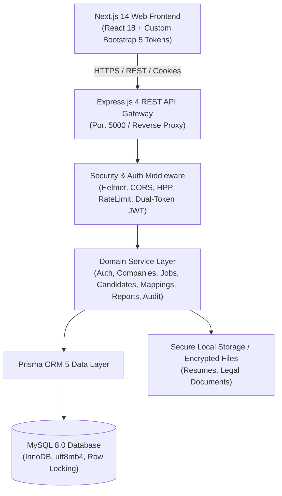
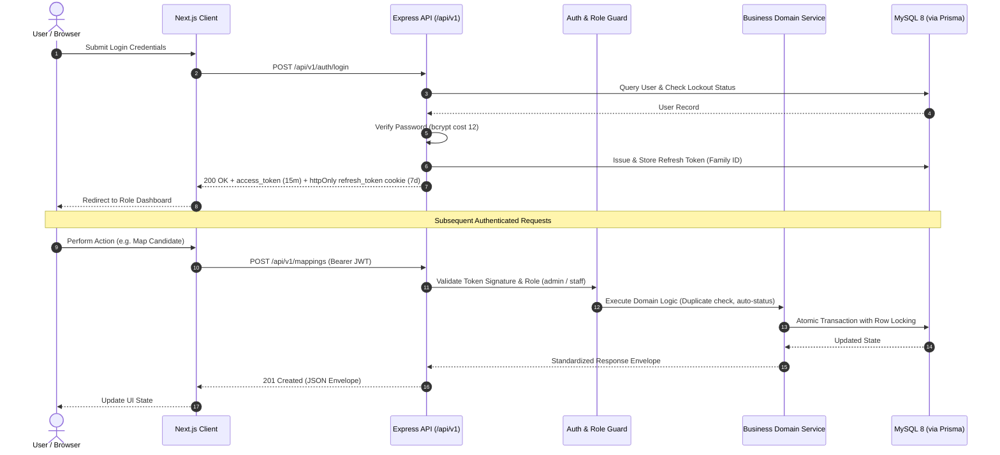
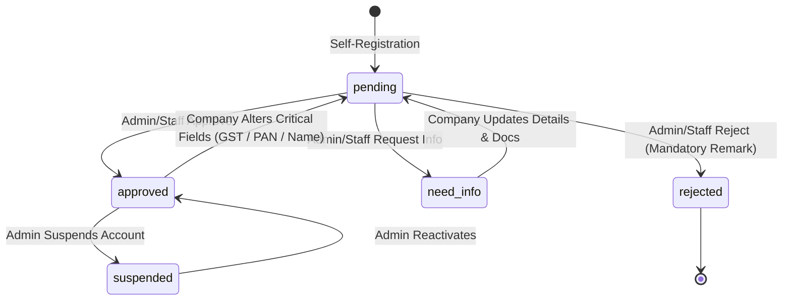
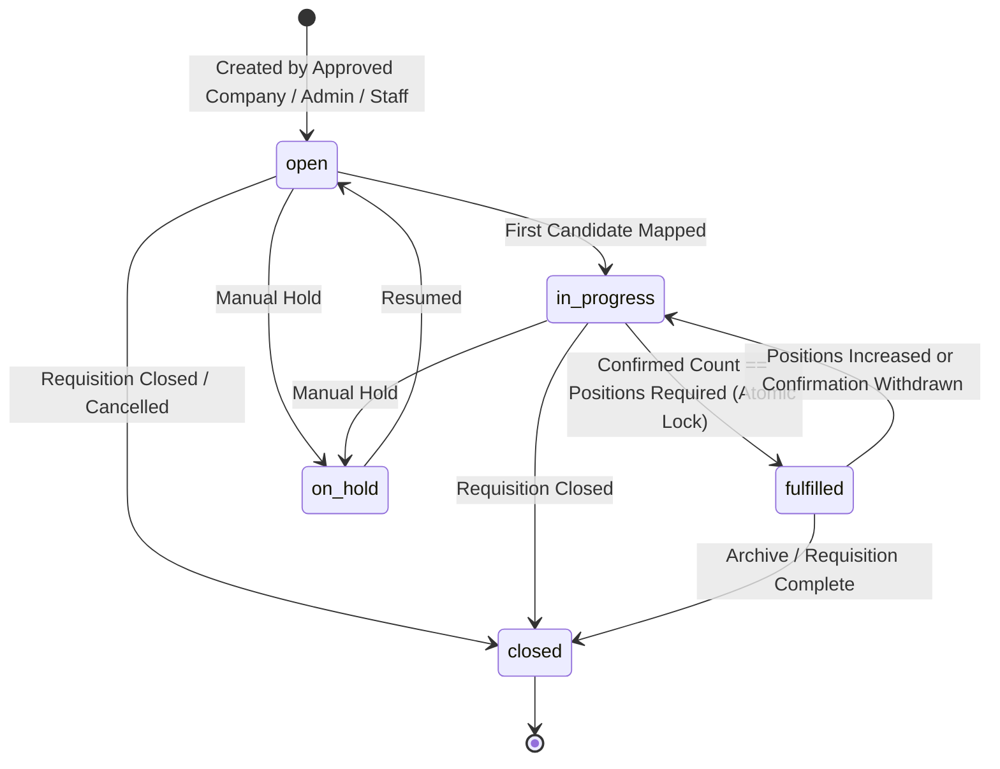
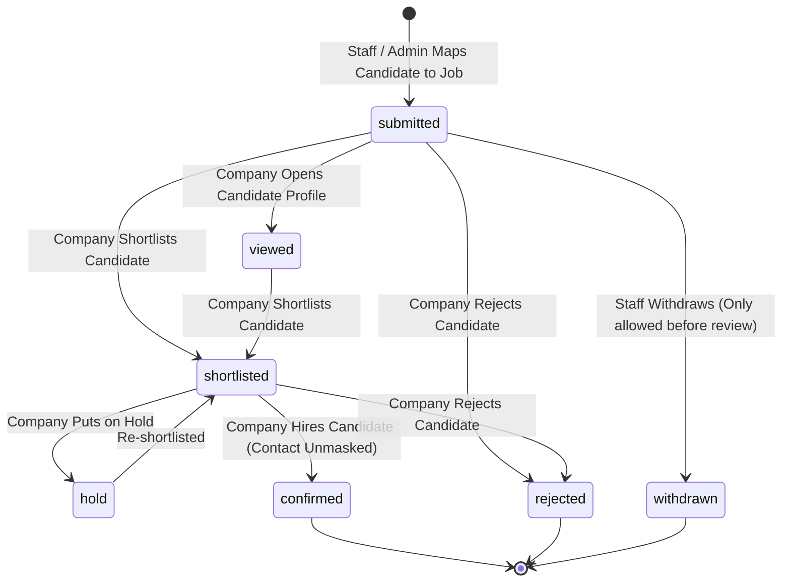

# System Architecture Documentation (ARCHITECTURE.md)

## 1. System Overview & Technology Stack

The **Recruitment Portal** is an enterprise-grade recruitment and candidate lifecycle management platform built to orchestrate interactions across Administrators, Recruiter Staff, and Employer Companies.

### Architectural Principles:
1. **Separation of Concerns**: Stateless Express REST API decoupled from Next.js server/client rendered presentation layer.
2. **Defensive Multi-Tenancy**: Strict BOLA/IDOR enforcement at the database query boundary for all company-scoped resources.
3. **Optimistic & Row-Locking Concurrency**: Atomic position reservation using `SELECT ... FOR UPDATE` row locks inside database transactions to prevent over-hiring race conditions.
4. **Decoupled Dashboard Aggregation**: Separation of aggregate analytical queries from high-throughput OLTP operational tables.
5. **Zero Trust File Handling**: Strict extension whitelisting, Zip slip traversal sanitization, and authenticated streaming endpoints.

---

## 2. Request Lifecycle & Authentication Flow

---

## 3. Core State Machines

### 3.1 Company Verification Lifecycle

### 3.2 Job Requisition Lifecycle

### 3.3 Candidate Mapping Lifecycle

---

## 4. Algorithmic Matching Engine

The automated candidate recommendation engine (`server/src/modules/mappings/matching.service.js`) computes candidate compatibility against job requirements on a normalized scale (0 to 100):

| Component | Weight | Calculation Method |
|---|---|---|
| **Skills Matching** | **50%** | Jaccard-weighted overlap between candidate skills and required job skills (`matched_skills / total_required_skills * 50`) |
| **Experience Compatibility** | **25%** | Linear penalty scoring based on deviation from `[experience_min, experience_max]`. Exact range = 25 pts; below/above penalized proportionally |
| **Location Match** | **15%** | City match = 15 pts; State match = 10 pts; Remote/Anywhere = 15 pts |
| **Qualification Match** | **10%** | Degree / Qualification level equivalence match |

---

## 5. Security & Boundary Hardening

1. **Multi-Tenant Scoping**: All queries on company assets enforce `where: { company_id: req.user.company_id }` for company users. Any cross-tenant access returns HTTP 404 (Resource Not Found) to eliminate information disclosure.
2. **Contact Privacy Guard**: Candidate contact details (`email`, `mobile`, `address`) are automatically masked with asterisks when returned to employer users unless the candidate mapping status is `confirmed`.
3. **Anti-Formula Injection**: All CSV and Excel export generators sanitize cell contents beginning with `=`, `+`, `-`, `@`, `\t`, or `\r` by prefixing a single quote `'`.
4. **Zip Slip Traversal Defense**: Zip archives uploaded for bulk candidates validate target extraction paths against canonical base directories, rejecting malicious path traversal tokens (`../`).

