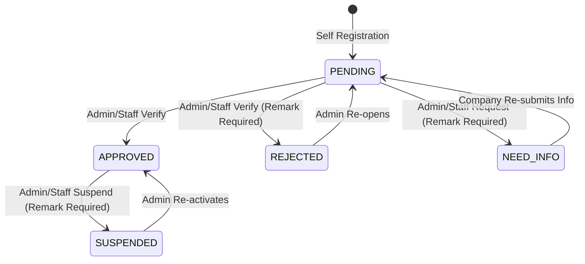
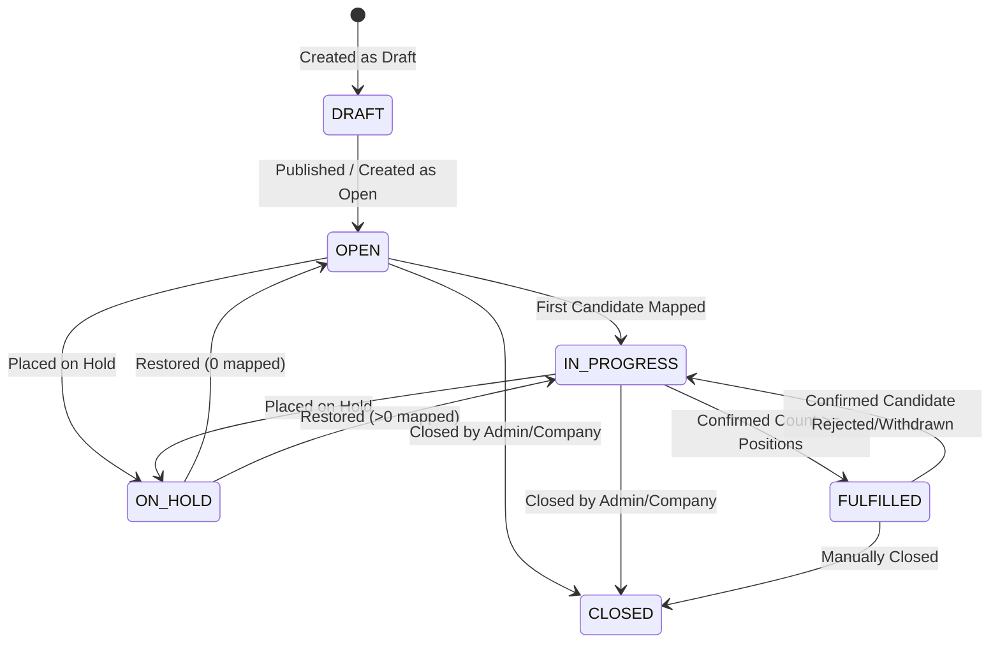
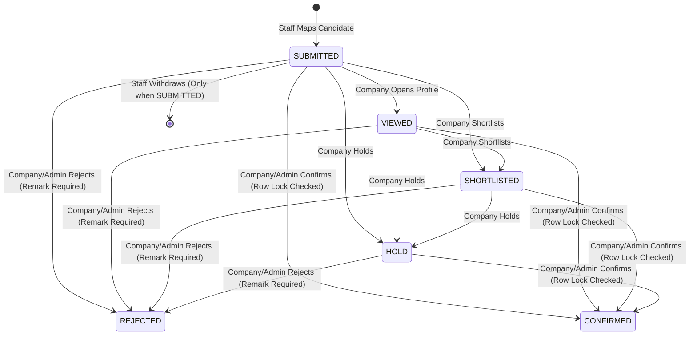

# Recruitment Portal System Architecture & Design Specification
**Date:** 2026-11-18  
**Document ID:** SPEC-2026-11-18-RP-01  
**Status:** Approved (Pre-Approved per Master Prompt Section 2)  

---

## 1. Intent and "The Why"
Staffing agencies and recruitment teams spend hundreds of hours navigating disjointed spreadsheets, unvetted candidate emails, and slow client approval cycles. The **Recruitment Portal** is a unified, high-reliability operational system connecting:
1. **Admins:** Full control, governance, system configuration, masters, and macro-level company-wise placement performance oversight.
2. **Staff (Recruiters):** Fast candidate sourcing, intelligent skill-weighted resume matching, candidate mapping to open job orders, and pipeline progression.
3. **Companies (Clients):** Frictionless registration, job requirement posting, private candidate review with resume inspection, shortlisting, and placement confirmation.

The system is designed for **maximum transactional integrity** (zero duplicate job codes, zero race conditions on position fulfillment, 100% tenant isolation, and strict candidate contact protection).

---

## 2. Goals, Non-Goals, and Anti-Goals

### 2.1 Goals
- **Multi-Role Security:** Explicit role separation between Admin, Staff, and Company with zero privilege leaks or IDOR across tenants.
- **Reliable Workflows:** End-to-end automation from company verification → job creation → candidate matching & mapping → company confirmation → auto-fulfillment.
- **Race-Condition Proof:** Multi-user concurrent confirms cannot exceed the positions required on any job order.
- **Enterprise-Grade Auditability:** Every status change, login attempt, profile update, and data export is immutably logged with before/after diffs.
- **Modern Responsive Design:** Fast, high-density, accessible (WCAG AA) interface built with customized Bootstrap 5 design tokens, avoiding generic default styles.
- **Verified Deliverables:** 100% of functional requirements traceable to passing integration and end-to-end regression tests.

### 2.2 Non-Goals (Out of Scope for Initial Release)
- Building custom video interview calling / WebRTC conferencing tools directly in-portal (scheduled links are tracked via notes/timeline).
- Direct automated payroll processing or banking gateway integration (handled via downstream placement reports).
- Native mobile apps (iOS/Android native binaries); instead, high-fidelity responsive mobile web is guaranteed.

### 2.3 Anti-Goals (What We Must Avoid)
- **Do not leak candidate contact information** to companies prior to formal candidate confirmation (prevents client disintermediation).
- **Do not expose internal recruiter notes** or staff margin calculations in company API responses.
- **Do not trust client-supplied identifiers** (`companyId`, `uploadedBy`, etc.) in HTTP payloads.
- **Do not allow soft-deleted records to lock users out** or collide with unique constraints.
- **Do not execute raw unescaped SQL queries** or allow Excel formula injection in report exports.

---

## 3. Constraints & Operating Environment
- **Frontend Stack:** Next.js 14+ (App Router), React 18, Bootstrap 5.3 + `react-bootstrap`. Custom Sass / CSS variable tokens (no Tailwind or competing CSS frameworks).
- **Backend Stack:** Node.js 20 LTS, Express 4, Prisma ORM 5.
- **Database:** MySQL 8 (InnoDB, `utf8mb4_unicode_ci`), foreign key constraints, FULLTEXT index on candidate profile text.
- **Authentication:** JWT Access Token (15m httpOnly cookie), Rotating Refresh Token (7d httpOnly cookie) with family reuse detection, bcrypt hashing (cost 12), and lockout protection.
- **Execution Strategy:** Test-Driven Development (TDD) with separate test database environments, worktrees/feature branches per phase, and strict verification commands before declaring completion.

---

## 4. Architectural Approaches & Trade-Offs

### 4.1 Database Access & Data Integrity
- **Considered Approach A (Sequelize ORM):** Allowed in PDF overview, but lacks modern TypeScript/type-safe generation and has verbose migration workflows.
- **Considered Approach B (Prisma ORM with Authoritative SQL):** Chosen approach. We author authoritative MySQL 8 SQL schema (`001_schema.sql`) enforcing native constraints, then leverage Prisma client generation (`prisma db pull` / `prisma generate`) for type-safe query execution and `prisma.$transaction` for atomic operations.

### 4.2 Candidate Contact Masking Strategy
- **Considered Approach A (Client-Side Masking):** Frontend hides phone/email unless status is confirmed. Rejected: Malicious clients inspecting Network tabs could extract full contact details.
- **Considered Approach B (Serializer Boundary Masking):** Chosen approach. Dedicated candidate serializer `serializeCandidate(cand, requestingUser, status)` strips or masks email and mobile before sending JSON to company users unless `status === 'confirmed'`.

### 4.3 Position Fulfillment & Concurrent Confirms
- **Considered Approach A (Optimistic Locking):** Check count in application code then insert. Rejected: Highly vulnerable to race conditions when two users click "Confirm" simultaneously on the last available vacancy.
- **Considered Approach B (Pessimistic Row Lock in Transaction):** Chosen approach. Execute `SELECT positions_required, status FROM jobs WHERE id = ? FOR UPDATE` inside `prisma.$transaction`. Re-evaluate confirmed count under lock; reject with HTTP 422 if filled.

### 4.4 Dashboard Aggregation Architecture
- **Problem:** Direct joins across `jobs` and `job_candidates` multiply `positions_required` when multiple candidates exist for a single job.
- **Chosen Solution:** Decouple aggregations using SQL CTEs or independent subqueries. Positions are aggregated per company from `jobs`, while candidate statuses are aggregated from `job_candidates`, joined cleanly on `company_id`.

---

## 5. System State Machines

### 5.1 Company Lifecycle

### 5.2 Job Lifecycle

### 5.3 Candidate Mapping Lifecycle

---

## 6. What Is Left to the Builder (Phase Execution Sequence)
The builder must execute the 10 phases in strict order:
1. **Phase 1:** Repository setup, database schema, Prisma, seed, Express skeleton, JWT auth engine, Next.js layout, and route guards.
2. **Phase 2:** Generic masters REST framework (12 master entities), cascading locations, staff/admin CRUD, and shared UI component library.
3. **Phase 3:** Multi-step company registration, document upload pipelines, admin verification desk, and notification triggers.
4. **Phase 4:** Job requirements module, race-safe sequential job code generation, rich-text sanitization, and staff assignment.
5. **Phase 5:** Candidate database, FULLTEXT search with LIKE fallback, private resume streaming, and 200-row bulk Excel/Zip ingest.
6. **Phase 6:** Match scoring algorithm, mapping workflows, company candidate review portal, and concurrency-locked fulfillment.
7. **Phase 7:** Multi-role dashboards (Admin company-wise with decoupled SQL, Staff, Company), report exporters (XLSX, CSV, PDF), and deadline crons.
8. **Phase 8:** Centralized audit logging with diff inspection, trash/restore manager, and dynamic system settings (SMTP test).
9. **Phase 9:** 9-track OWASP and business logic security audit, exploit reproduction, regression test creation, and hardening.
10. **Phase 10:** Comprehensive verification (F1-F14 E2E Playwright tests, load test, a11y checks), full documentation, and release handover.
